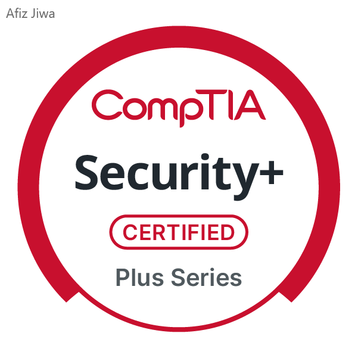
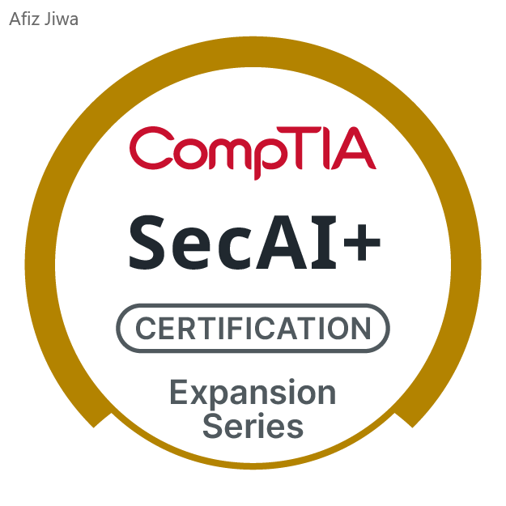

# CompTIA Certifications

| Certification | Exam | Issued | Expires |
|---|---|---|---|
| [Security+](#comptia-security-sy0-701) | SY0-701 | May 30, 2026 | May 30, 2029 |
| [Linux+](#comptia-linux-xk0-006) | XK0-006 | June 4, 2026 | June 4, 2029 |
| [SecAI+](#comptia-secai-cy0-001) | CY0-001 | June 11, 2026 | June 11, 2029 |

All three can also be verified at [verify.CompTIA.org](http://verify.CompTIA.org) using the code on each certificate. 

---

## CompTIA Security+ (SY0-701)

* **Issued:** May 30, 2026 | **Expires:** May 30, 2029
* [Verify Credential on Credly](https://www.credly.com/badges/7b8d83c2-a947-4f55-8076-bbb92724c98d)
* [Download Official PDF](./CompTIA%20Security+%20ce%20certificate.pdf)

---

## CompTIA Linux+ (XK0-006)

* **Issued:** June 4, 2026 | **Expires:** June 4, 2029
* [Verify Credential on Credly](https://www.credly.com/badges/657af150-9a1f-4763-9637-a8c8e9f75199)
* [Download Official PDF](./CompTIA%20Linux+%20ce%20certificate.pdf)

---

## CompTIA SecAI+ (CY0-001)

* **Issued:** June 11, 2026 | **Expires:** June 11, 2029
* [Verify Credential on Credly](https://www.credly.com/badges/807b97b2-1508-4ab0-aecb-f76d5645923a)
* [Download Official PDF](./CompTIA%20SecAI%20certificate.pdf)
