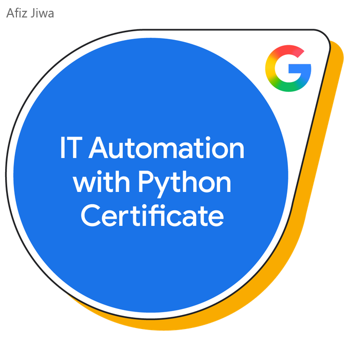

# Coursera Certificates

| Certificate | Issuer | Issued | Verify |
|---|---|---|---|
| [Cybersecurity & IT Support (badge)](#cybersecurity--it-support) | San Diego Workforce Partnership, powered by Coursera | August 30, 2026 | [Coursera](https://www.coursera.org/account/accomplishments/badge/OJcXOXKoR3-XFzlyqLd_qA) |
| [Google IT Automation with Python](#google-it-automation-with-python) | Google, via Coursera | April 10, 2026 | [Coursera](https://www.coursera.org/account/accomplishments/specialization/L3BFS9RMMVSA) |

---

## Cybersecurity & IT Support

* **Issuer:** San Diego Workforce Partnership, powered by Coursera | **Issued:** August 30, 2026
* [Verify Badge on Coursera](https://www.coursera.org/account/accomplishments/badge/OJcXOXKoR3-XFzlyqLd_qA)

A cybersecurity pathway with optional IT support training. It covers 14 courses:

**Cybersecurity (Google)**
1. Foundations of Cybersecurity
2. Play It Safe: Manage Security Risks
3. Connect and Protect: Networks and Network Security
4. Tools of the Trade: Linux and SQL
5. Assets, Threats, and Vulnerabilities
6. Sound the Alarm: Detection and Response
7. Automate Cybersecurity Tasks with Python
8. Put It to Work: Prepare for Cybersecurity Jobs
9. Office of the CISO Institute: Cybersecurity Essentials

**IT Support (Google)**
1. Technical Support Fundamentals
2. The Bits and Bytes of Computer Networking
3. Operating Systems and You: Becoming a Power User
4. System Administration and IT Infrastructure Services
5. IT Security: Defense against the digital dark arts

---

## Google IT Automation with Python

* **Issuer:** Google, via Coursera | **Completed:** April 10, 2026
* [Verify Certificate on Coursera](https://coursera.org/verify/professional-cert/L3BFS9RMMVSA)
* [Download Official PDF](./it-automation-python-certificate.pdf)

A professional certificate covering Python, Git and IT automation.
