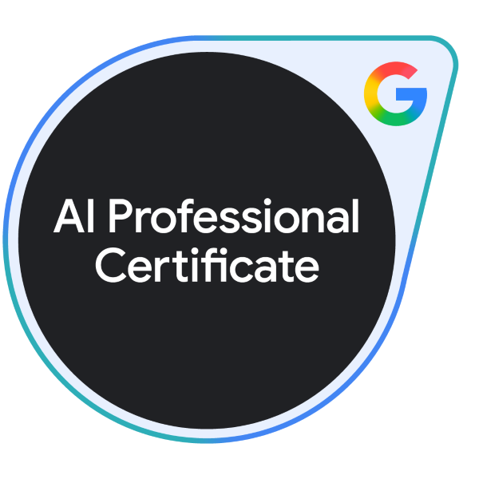

# Coursera Certificates

Professional certificates earned through Coursera.

| Certificate | Issuer | Issued | Verify |
|---|---|---|---|
| [Google Cybersecurity](#google-cybersecurity) | Google, via Coursera | January 18, 2026 | [Credly](https://www.credly.com/badges/72a2fc12-4777-41ee-b3d4-f6aabb5e34e7) · [Coursera](https://coursera.org/verify/professional-cert/W2FUS873ORJU) |
| [Google IT Automation with Python](#google-it-automation-with-python) | Google, via Coursera | April 10, 2026 | [Credly](https://www.credly.com/badges/d7c9362b-35ca-4c9c-a9a5-40d6d1678c22) · [Coursera](https://coursera.org/verify/professional-cert/L3BFS9RMMVSA) |
| [Google AI Professional Certificate](#google-ai-professional-certificate) | Google, via Coursera | March 6, 2026 | [Credly](https://www.credly.com/badges/bd99e866-3f98-4af7-8797-e9a54a4c7cd5) · [Coursera](https://coursera.org/verify/professional-cert/TW45TE367GVZ) |

---

## Google Cybersecurity

Afiz Jiwa 

* **Issuer:** Google, via Coursera | **Issued:** January 18, 2026
* [Verify Credential on Credly](https://www.credly.com/badges/72a2fc12-4777-41ee-b3d4-f6aabb5e34e7)
* [Verify Certificate on Coursera](https://coursera.org/verify/professional-cert/W2FUS873ORJU)
* [Download Official PDF](./google-cybersecurity-certificate.pdf)

A professional certificate covering security frameworks, network security, Linux, SQL, threat detection and incident response, and Python for security tasks.

---

## Google IT Automation with Python

Afiz Jiwa 

* **Issuer:** Google, via Coursera | **Completed:** April 10, 2026
* [Verify Credential on Credly](https://www.credly.com/badges/d7c9362b-35ca-4c9c-a9a5-40d6d1678c22)
* [Verify Certificate on Coursera](https://coursera.org/verify/professional-cert/L3BFS9RMMVSA)
* [Download Official PDF](./it-automation-python-certificate.pdf)

A professional certificate covering Python, Git and IT automation.

---

## Google AI Professional Certificate

Afiz Jiwa 

* **Issuer:** Google, via Coursera | **Issued:** March 6, 2026
* [Verify Credential on Credly](https://www.credly.com/badges/bd99e866-3f98-4af7-8797-e9a54a4c7cd5)
* [Verify Certificate on Coursera](https://coursera.org/verify/professional-cert/TW45TE367GVZ)
* [Download Official PDF](./google-ai-professional-certificate.pdf)

An eight-course professional certificate on applying AI to brainstorming, research, communication, content creation, data analysis and vibe coding, with a portfolio of AI work.
