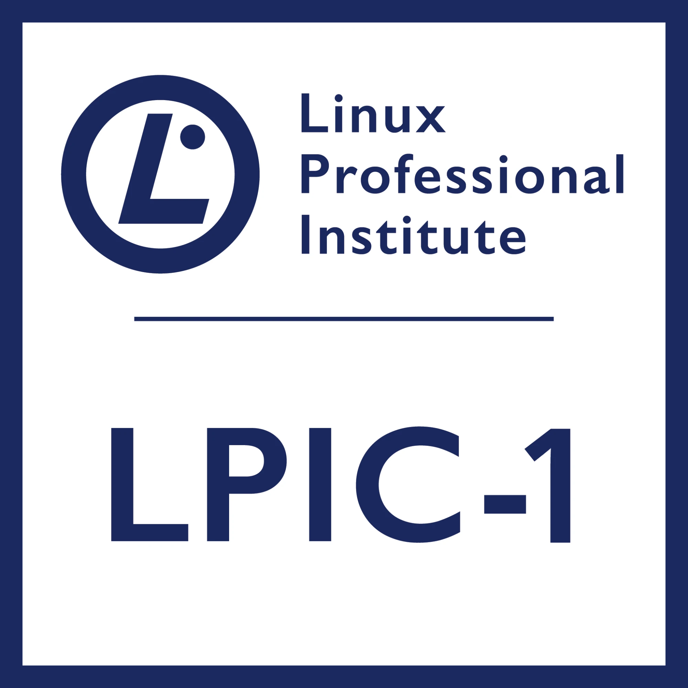
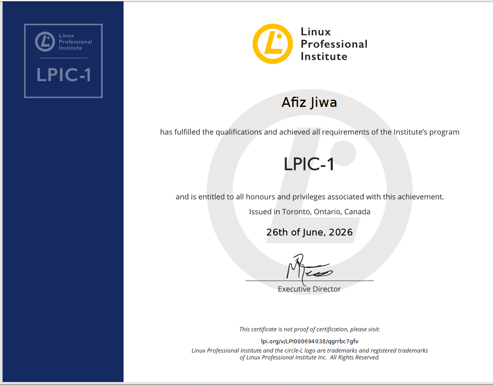
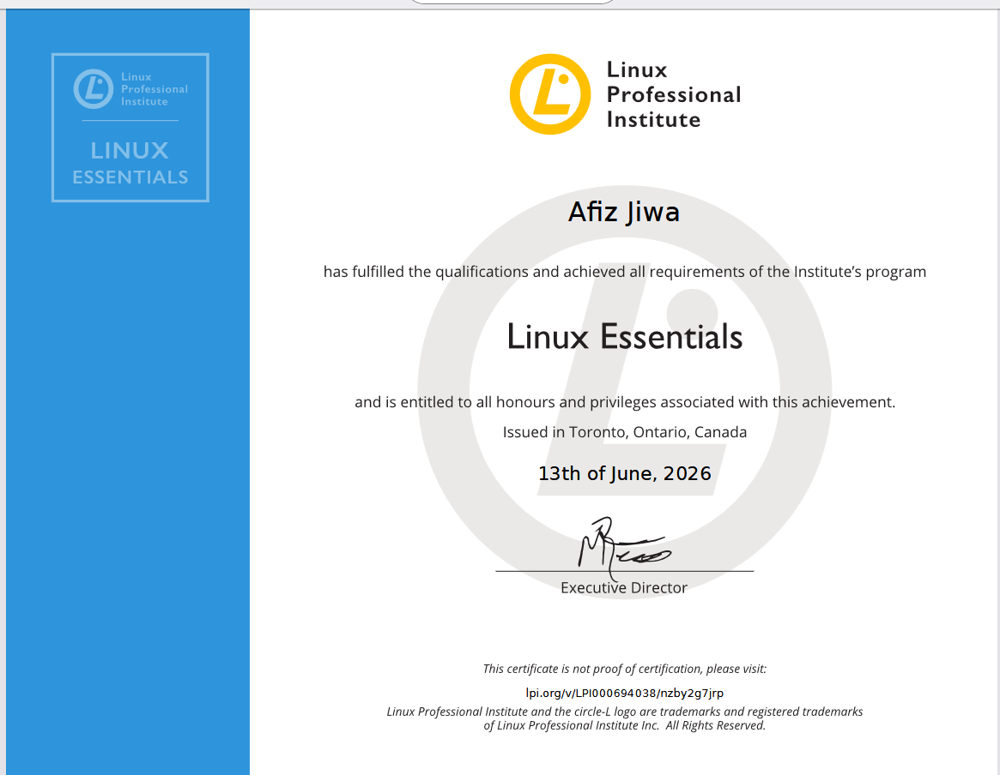

# Linux Professional Institute (LPI) Certifications

| Certification | Issued | Verify |
|---|---|---|
| [LPIC-1](#lpic-1) | June 26, 2026 | [Credly](https://www.credly.com/badges/d6a2e750-9b11-49e7-8f2b-53546391e043) · [LPI](https://lpi.org/v/LPI000694038/qgrrbc7gfv) |
| [Linux Essentials](#linux-essentials) | June 13, 2026 | [Credly](https://www.credly.com/badges/06fa85e2-e607-48c9-a9fb-831e104a7b6a) · [LPI](https://lpi.org/v/LPI000694038/nzby2g7jrp) |

---

## LPIC-1

* **Issued:** June 26, 2026
* [Verify Credential on Credly](https://www.credly.com/badges/d6a2e750-9b11-49e7-8f2b-53546391e043)
* [Verify on LPI](https://lpi.org/v/LPI000694038/qgrrbc7gfv)

 

---

## Linux Essentials

* **Issued:** June 13, 2026
* [Verify Credential on Credly](https://www.credly.com/badges/06fa85e2-e607-48c9-a9fb-831e104a7b6a)
* [Verify on LPI](https://lpi.org/v/LPI000694038/nzby2g7jrp)

