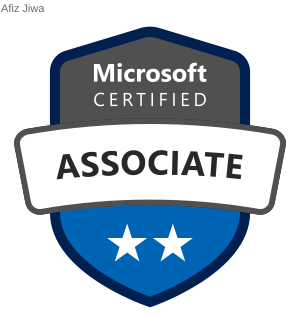

# Microsoft Certifications

| Certification | Exam | Earned | Expires | Verify |
|---|---|---|---|---|
| [Cybersecurity Architect Expert](#cybersecurity-architect-expert) | SC-100 | June 22, 2026 | June 22, 2027 | [Microsoft Learn](https://learn.microsoft.com/api/credentials/share/en-us/AfJiwa-3909/89443D1B7AB146BC?sharingId=333A4295D8E97B98) |
| [Identity and Access Administrator Associate](#identity-and-access-administrator-associate) | SC-300 | June 20, 2026 | June 20, 2027 | [Microsoft Learn](https://learn.microsoft.com/en-us/users/afjiwa-3909/credentials/8edff3e9d9b7a36a) |
| [Information Security Administrator Associate](#information-security-administrator-associate) | SC-401 | June 24, 2026 | June 24, 2027 | [Microsoft Learn](https://learn.microsoft.com/api/credentials/share/en-us/AfJiwa-3909/65834D9ABB93C2A?sharingId=333A4295D8E97B98) |
| [Azure Administrator Associate](#azure-administrator-associate) | AZ-104 | June 27, 2026 | June 27, 2027 | [Microsoft Learn](https://learn.microsoft.com/en-us/users/afjiwa-3909/credentials/d54f56cbfc916ce3) |

---

## Cybersecurity Architect Expert

* **Exam:** SC-100 | **Earned:** June 22, 2026 | **Expires:** June 22, 2027
* **Credential ID:** 89443D1B7AB146BC | **Certification number:** J463E7-8F5DDB
* [Verify on Microsoft Learn](https://learn.microsoft.com/api/credentials/share/en-us/AfJiwa-3909/89443D1B7AB146BC?sharingId=333A4295D8E97B98)
* [View Certificate](./sc-100-certificate.png)

---

## Identity and Access Administrator Associate

* **Exam:** SC-300 | **Earned:** June 20, 2026 | **Expires:** June 20, 2027
* **Credential ID:** 8EDFF3E9D9B7A36A | **Certification number:** 863485-36D06A
* [Verify on Microsoft Learn](https://learn.microsoft.com/en-us/users/afjiwa-3909/credentials/8edff3e9d9b7a36a)
* [View Certificate](./sc-300-certificate.png)

---

## Information Security Administrator Associate

* **Exam:** SC-401 | **Earned:** June 24, 2026 | **Expires:** June 24, 2027
* **Credential ID:** 65834D9ABB93C2A | **Certification number:** 11L3F4-631358
* [Verify on Microsoft Learn](https://learn.microsoft.com/api/credentials/share/en-us/AfJiwa-3909/65834D9ABB93C2A?sharingId=333A4295D8E97B98)
* [View Certificate](./sc-401-certificate.png)

---

## Azure Administrator Associate

* **Exam:** AZ-104 | **Earned:** June 27, 2026 | **Expires:** June 27, 2027
* **Credential ID:** D54F56CBFC916CE3 | **Certification number:** D8DG49-621879
* [Verify on Microsoft Learn](https://learn.microsoft.com/en-us/users/afjiwa-3909/credentials/d54f56cbfc916ce3)
* [View Certificate](./az-104-certificate.png)
