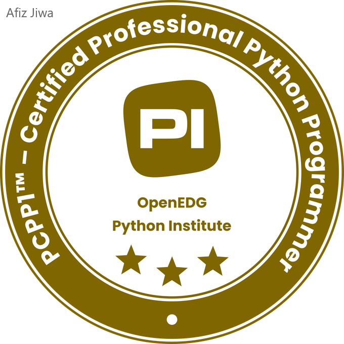
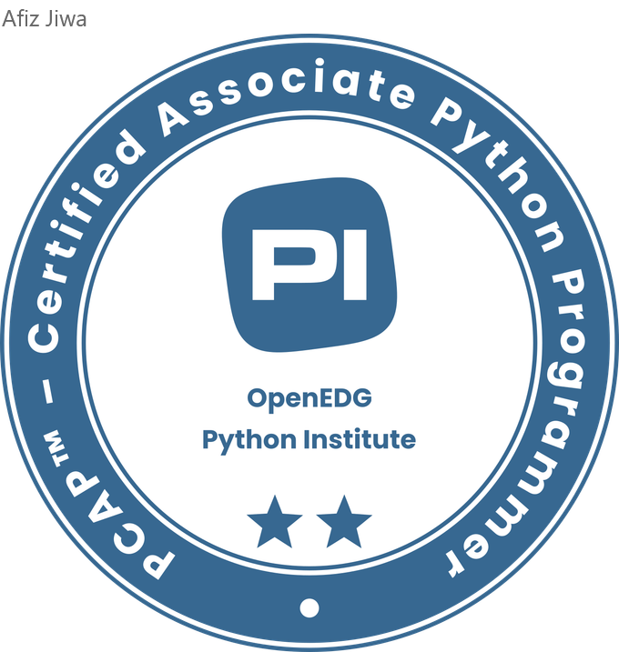
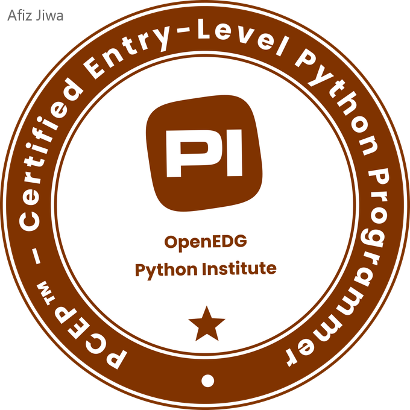

# OpenEDG Python Institute Certifications

| Certification | Exam | Issued | Verify |
|---|---|---|---|
| [PCPP1 – Certified Professional Python Programmer Level 1](#pcpp1--certified-professional-python-programmer-level-1) | PCPP-32-101 | June 24, 2026 | [Credly](https://www.credly.com/badges/8767001a-0beb-4b34-965e-25f5561646de) · [OpenEDG](https://verify.openedg.org/?id=T7Cd.JXbg.CS4U) |
| [PCAP – Certified Associate Python Programmer](#pcap--certified-associate-python-programmer) | PCAP-31-03 | June 16, 2026 | [Credly](https://www.credly.com/badges/a0cfacb5-15d1-42fc-9a93-25a13e683a64) · [OpenEDG](https://verify.openedg.org/?id=ysBq.CeoJ.gdhj) |
| [PCEP – Certified Entry-Level Python Programmer](#pcep--certified-entry-level-python-programmer) | PCEP-30-02 | June 2, 2026 | [Credly](https://www.credly.com/badges/2871bfa7-e76d-4f34-a54d-9495e6ec0e5d) · [OpenEDG](https://verify.openedg.org/?id=HZSb.MRm9.zhCr) |

---

## PCPP1 – Certified Professional Python Programmer Level 1

Afiz Jiwa 

* **Exam:** PCPP-32-101 | **Issued:** June 24, 2026
* [Verify Credential on Credly](https://www.credly.com/badges/8767001a-0beb-4b34-965e-25f5561646de)
* [Verify on OpenEDG](https://verify.openedg.org/?id=T7Cd.JXbg.CS4U)
* [Download Official PDF](./pcpp1-certificate.pdf)

---

## PCAP – Certified Associate Python Programmer

Afiz Jiwa 

* **Exam:** PCAP-31-03 | **Issued:** June 16, 2026
* [Verify Credential on Credly](https://www.credly.com/badges/a0cfacb5-15d1-42fc-9a93-25a13e683a64)
* [Verify on OpenEDG](https://verify.openedg.org/?id=ysBq.CeoJ.gdhj)
* [Download Official PDF](./pcap-certificate.pdf)

---

## PCEP – Certified Entry-Level Python Programmer

Afiz Jiwa 

* **Exam:** PCEP-30-02 | **Issued:** June 2, 2026
* [Verify Credential on Credly](https://www.credly.com/badges/2871bfa7-e76d-4f34-a54d-9495e6ec0e5d)
* [Verify on OpenEDG](https://verify.openedg.org/?id=HZSb.MRm9.zhCr)
* [Download Official PDF](./pcep-certificate.pdf)
