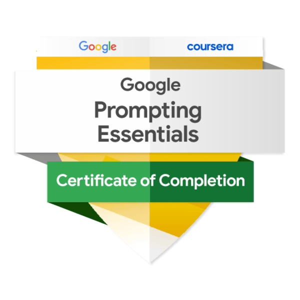
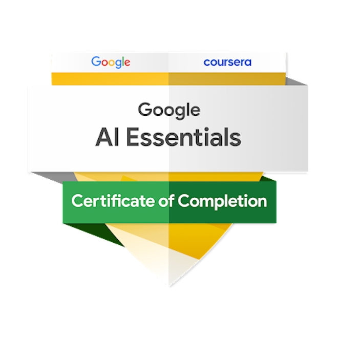

# Coursera Courses and Badges

Short courses and a program badge completed through Coursera.

| Certificate | Issuer | Issued | Verify |
|---|---|---|---|
| [Cybersecurity & IT Support (badge)](#cybersecurity--it-support) | San Diego Workforce Partnership / Coursera | August 30, 2026 | [Coursera](https://www.coursera.org/account/accomplishments/badge/OJcXOXKoR3-XFzlyqLd_qA) |
| [Google Prompting Essentials](#google-prompting-essentials) | Google, via Coursera | January 20, 2026 | [Credly](https://www.credly.com/badges/d235b2af-caf4-4bb7-bd26-d5f6511d4ca2) · [Coursera](https://coursera.org/verify/specialization/NDA10T2SQ3OT) |
| [Google AI Essentials](#google-ai-essentials) | Google, via Coursera | January 19, 2026 | [Credly](https://www.credly.com/badges/e21df7de-9aab-4e44-8b51-bc3530761d93) · [Coursera](https://coursera.org/verify/specialization/FOMMJ0O4YOVP) | 

---

## Cybersecurity & IT Support

Afiz Jiwa 

* **Issuer:** San Diego Workforce Partnership / Coursera | **Issued:** August 30, 2026
* [Verify Badge on Coursera](https://www.coursera.org/account/accomplishments/badge/OJcXOXKoR3-XFzlyqLd_qA)

A cybersecurity pathway with optional IT support training. It covers 14 courses:

**Cybersecurity (Google)**
1. Foundations of Cybersecurity
2. Play It Safe: Manage Security Risks
3. Connect and Protect: Networks and Network Security
4. Tools of the Trade: Linux and SQL
5. Assets, Threats, and Vulnerabilities
6. Sound the Alarm: Detection and Response
7. Automate Cybersecurity Tasks with Python
8. Put It to Work: Prepare for Cybersecurity Jobs
9. Office of the CISO Institute: Cybersecurity Essentials

**IT Support (Google)**
1. Technical Support Fundamentals
2. The Bits and Bytes of Computer Networking
3. Operating Systems and You: Becoming a Power User
4. System Administration and IT Infrastructure Services
5. IT Security: Defense against the digital dark arts

---

## Google Prompting Essentials

Afiz Jiwa 

* **Issuer:** Google, via Coursera | **Issued:** January 20, 2026
* [Verify Credential on Credly](https://www.credly.com/badges/d235b2af-caf4-4bb7-bd26-d5f6511d4ca2)
* [Verify Certificate on Coursera](https://coursera.org/verify/specialization/NDA10T2SQ3OT)
* [Download Official PDF](./google-prompting-essentials-certificate.pdf)

A certificate of completion covering how to write effective prompts for generative AI tools.

---

## Google AI Essentials

Afiz Jiwa 

* **Issuer:** Google, via Coursera | **Issued:** January 19, 2026
* [Verify Credential on Credly](https://www.credly.com/badges/e21df7de-9aab-4e44-8b51-bc3530761d93)
* [Verify Certificate on Coursera](https://coursera.org/verify/specialization/FOMMJ0O4YOVP)
* [Download Official PDF](./google-ai-essentials-certificate.pdf)

A certificate of completion covering how to use generative AI tools at work productively and responsibly.
